# Cisco Inter-VLAN Routing

## 1. Project Overview

This project demonstrates inter-VLAN routing using a Cisco 2901 router and a switch in Cisco Packet Tracer.

Two VLANs were created to separate the Management and Finance departments. Router-on-a-stick was configured to allow communication between devices in different VLANs.

## 2. Network Topology

The network consists of:
- 1 Cisco 2901 router
- 1 switch
- 4 PCs
- 2 VLANs

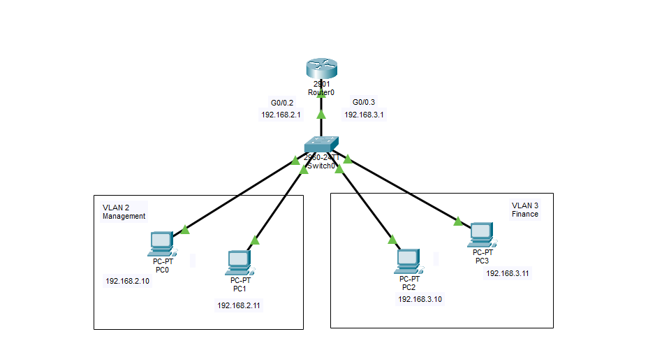

## 3. IP Addressing

All PCs use a /24 subnet mask (255.255.255.0).

| PC | IP Address | VLAN | Department | Default Gateway |
|---|---|---|---|---|
| PC0 | 192.168.2.10 | VLAN 2 | Management | 192.168.2.1 |
| PC1 | 192.168.2.11 | VLAN 2 | Management | 192.168.2.1 |
| PC2 | 192.168.3.10 | VLAN 3 | Finance | 192.168.3.1 |
| PC3 | 192.168.3.11 | VLAN 3 | Finance | 192.168.3.1 |

## 4. Configuration & Implementation

### 4.1 VLAN Creation and Switch Port Assignment

Two VLANs were created:
- VLAN 2 – Management
- VLAN 3 – Finance

Switch access ports were assigned as follows:
- Fa0/1–Fa0/2 → VLAN 2
- Fa0/3–Fa0/4 → VLAN 3

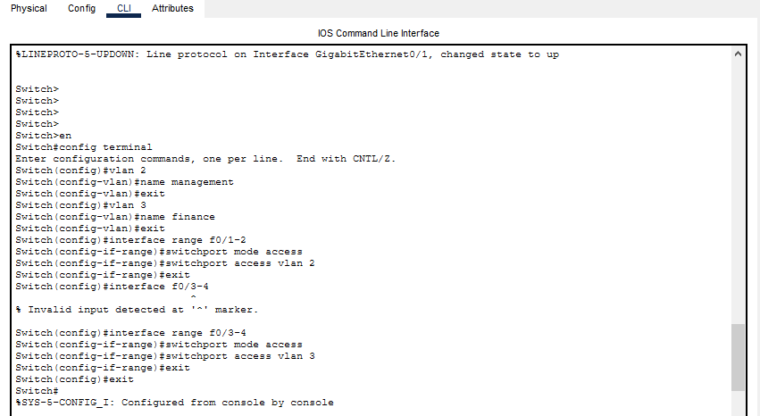

### 4.2 Initial Connectivity Testing

Connectivity between PCs in the same VLAN was tested before configuring inter-VLAN routing.

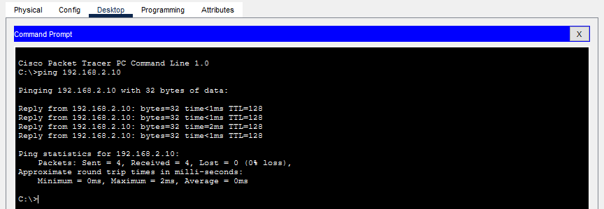

Communication between different VLANs was also tested before router configuration.

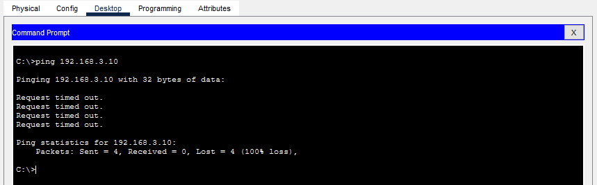

### 4.3 Trunk Configuration

The switch uplink port connected to the router was configured as a trunk to carry traffic for both VLANs using 802.1Q encapsulation.

The trunk was configured to allow VLAN 2 and VLAN 3.

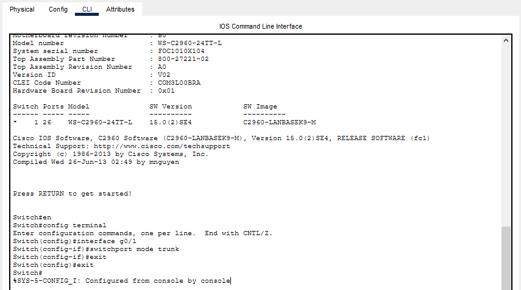

### 4.4 Router Configuration

The router's physical interface was enabled using `no shutdown`.

Subinterfaces were configured for each VLAN using 802.1Q encapsulation:
- G0/0.2 – VLAN 2 – 192.168.2.1
- G0/0.3 – VLAN 3 – 192.168.3.1

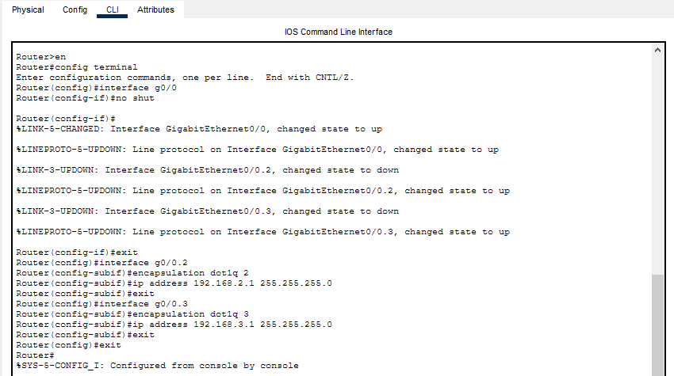

### 4.5 Final Connectivity Testing

After configuring router-on-a-stick, connectivity between VLAN 2 and VLAN 3 was successfully tested.

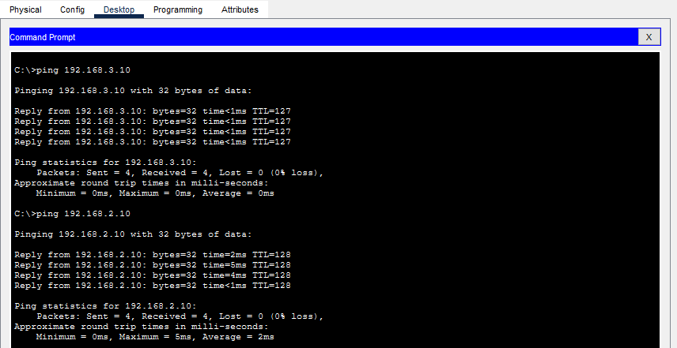

### 4.6 Configuration Verification

**VLAN verification:**

The `show vlan brief` command verified the VLANs and switch port assignments.

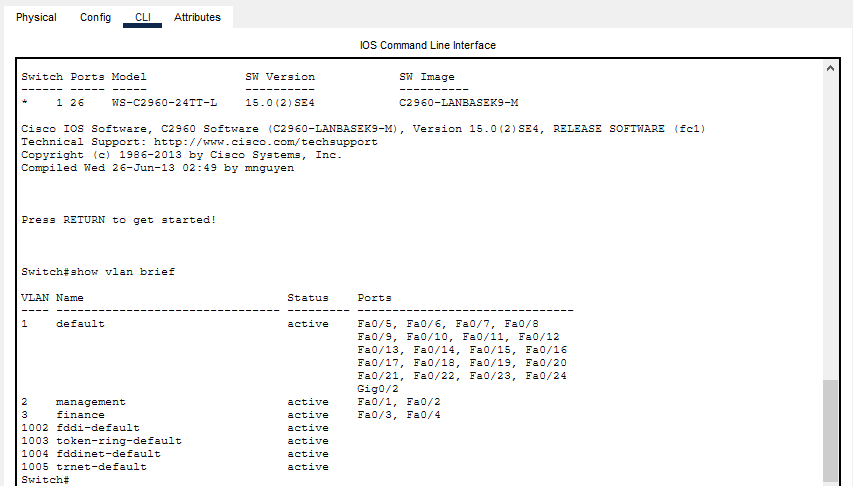

**Router interface verification:**

The `show ip interface brief` command verified the router interface and subinterface status.

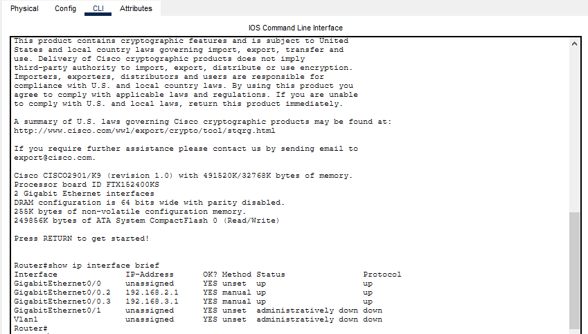

## 5. Troubleshooting

### Scenario 1: Incorrect Default Gateway

**Problem:** PC0 could communicate with devices in the same VLAN but could not reach devices in another VLAN.

**Diagnosis:** PC0 had an incorrect default gateway configured.

**Cause:** The configured gateway was `192.168.2.10` instead of `192.168.2.1`.

**Solution:** Corrected PC0's default gateway to `192.168.2.1`.

**Verification:** PC0 successfully communicated with devices in the same VLAN and across VLANs.

**Before**

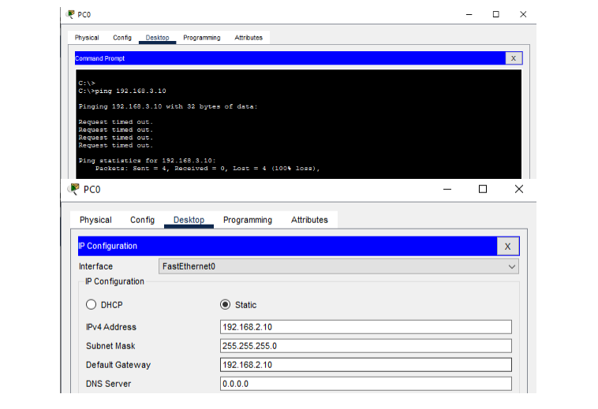

**After**

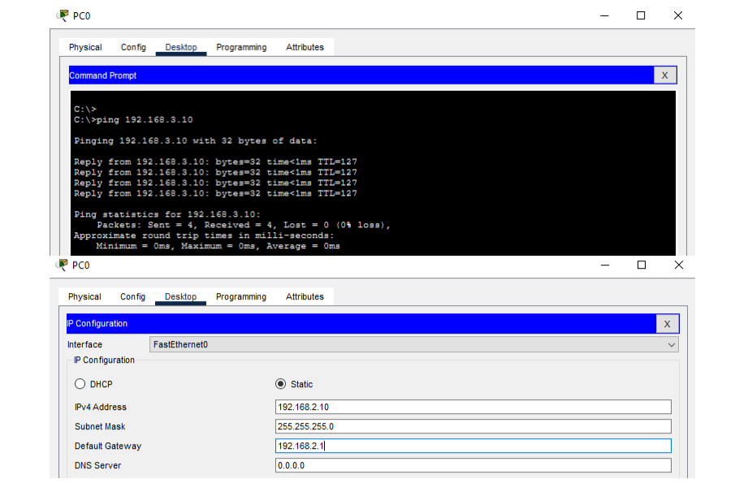

### Scenario 2: Incorrect VLAN Assignment

**Problem:** PC3 could not communicate with PC2.

**Diagnosis:** The `show vlan brief` command revealed that switch port f0/4 was assigned to VLAN 2 instead of VLAN 3.

**Cause:** PC3 was connected to f0/4, which was incorrectly assigned to the Management VLAN.

**Solution:** Reassigned f0/4 to VLAN 3 using:

```cisco
interface f0/4
switchport mode access
switchport access vlan 3
```

**Verification:** PC3 successfully communicated with PC2 after the port was restored to VLAN 3.

**Before**

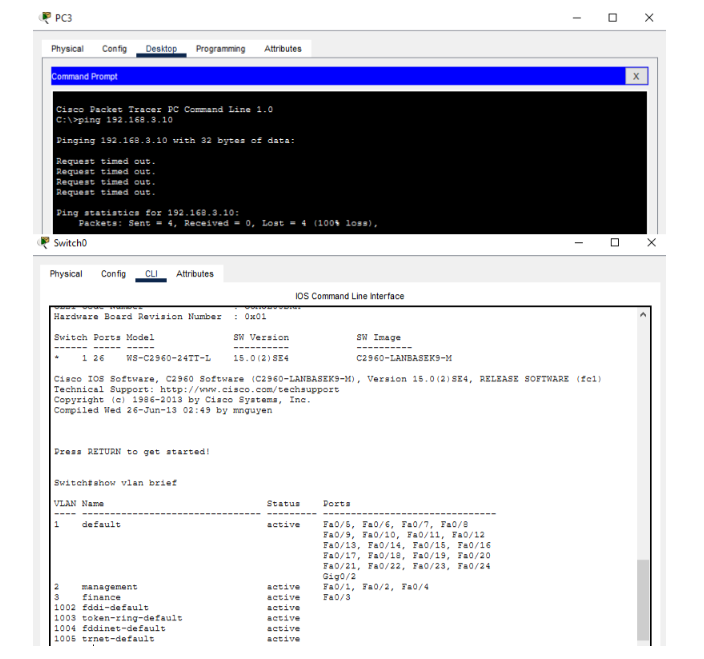

**After**

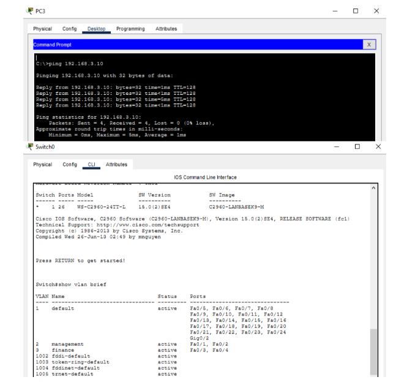
